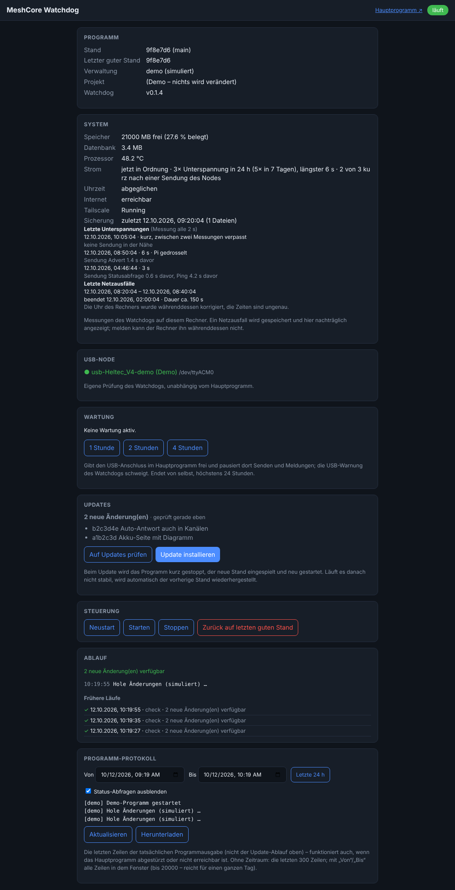
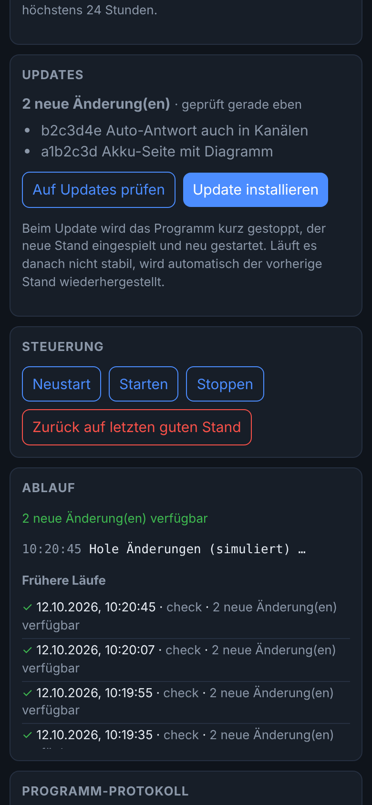

# MeshCore Watchdog

Kleines, eigenständiges Programm, das das Hauptprogramm
**MeshCore Remote** (eigenes Repo: [meshcore-remote-pi](https://github.com/BlackSky2035/meshcore-remote-pi), Ordnername `meshcore-remote`) auf einem Rechner **überwacht, aktualisiert und steuert**.

> **Inoffiziell:** Privates Hobbyprojekt, **nicht** mit MeshCore verbunden und nicht offiziell.
> **KI-generiert, keine Verantwortung:** Dieses gesamte Projekt (Code, Tests und Dokumentation) wurde mit Hilfe von künstlicher Intelligenz
> (Claude von Anthropic) erstellt. Der Code wurde vom Veröffentlichenden **nicht überprüft**, und er **übernimmt keine Verantwortung und keine Haftung**
> für Fehler, Schäden, Datenverlust, Funkstörungen oder Verstöße gegen Funk- und Datenschutzvorschriften. Nutzung ausschließlich auf eigenes Risiko.
> Wer das Programm betreibt, ist selbst dafür verantwortlich, dass es mit den örtlichen Funkregeln (z. B. Sendezeit im 868-MHz-Band) vereinbar ist.
>
> **Stand:** Im Test mit simuliertem Git/systemd geprüft; auf einem Raspberry Pi 3 B im Betrieb, aber nicht jede Funktion ist an echter Hardware geprüft
> (bei den einzelnen Abschnitten steht, was fehlt). Nutzung auf eigene Verantwortung, ohne Gewähr.
> **Lizenz:** MIT mit „Commons Clause“, siehe [LICENSE](LICENSE): nutzen, ändern und kostenlos weitergeben ja, **verkaufen** (auch als bezahlter Dienst oder Support) nein. Das ist keine Open-Source-Lizenz im Sinne der OSI.
>
> **Installation auf dem Raspberry Pi** Schritt für Schritt: [Anleitung im Repo des Hauptprogramms](https://github.com/BlackSky2035/meshcore-remote-pi/blob/main/docs/raspberry-pi.md).

Gedacht für den Raspberry Pi (systemd-Modus). Daneben gibt es einen Prozess-Modus ohne systemd, nur zum Ausprobieren. Andere Systeme (macOS, Windows) sind **nicht getestet**.

- Nur Python-Standardbibliothek (Python ≥ 3.11), **kein venv, keine Abhängigkeiten**. Ein kaputtes
  Update des Hauptprogramms kann den Watchdog deshalb nicht mitreißen.
- Eigener Port (Standard 8100) mit einer Weboberfläche: Status, Update prüfen/installieren,
  Neustart/Start/Stopp, Rollback, Protokoll.
- **Nichts passiert automatisch.** Updates werden nur auf Knopfdruck (oder per Kommandozeile)
  geholt. Der Pi zieht von selbst nichts von GitHub.

## So sieht es aus

Aufnahmen des **Demo-Modus** (`python -m watchdog --demo`): Es ist alles simuliert, die Werte sind erfunden, nichts wird verändert.

<table>
<tr>
<td><br><sub>Desktop: Programm, System (Unterspannung, Netzausfälle), Wartung, Updates, Steuerung, Protokoll</sub></td>
<td><br><sub>Handy: Bereich „Updates“ mit „Auf Updates prüfen“ und „Update installieren“</sub></td>
</tr>
</table>

## USB-Anzeige
Der Watchdog prüft selbst (ohne das Hauptprogramm zu fragen), ob ein USB-Node (`/dev/ttyACM*`, `/dev/ttyUSB*`)
am Rechner hängt, und zeigt es in einer eigenen Karte. Mit `expect_usb = true` in der `config.toml` wird ein fehlender Node
(nach 30 s) als Problem oben gemeldet. Nicht an echter Hardware getestet.

## System, Netz und Sicherung
Eigene Karte „System“: Speicher, Datenbankgröße, Prozessortemperatur, Strom (Unterspannung auf dem Pi), Uhrzeit-Abgleich, Internet/Tailscale
und eine Liste der letzten Netzausfälle (bleibt über Neustarts erhalten). Warnungen erscheinen oben unter „Programm“.
Netzausfälle stehen mit Beginn und Ende in `data/netlog.jsonl`. Der Pi hat keine Echtzeituhr und stellt seine Zeit nach dem Start per Netz neu, genau dann, wenn auch
das Netz fehlt: Die Uhr kann zwischen Beginn und Ende des Ausfalls springen (sichtbar z. B. als Ende VOR dem Beginn). Deshalb wird je Eintrag auch die Laufzeit seit dem Start
mitgeschrieben, die so etwas nicht beeinflusst. Ist die Uhr gesprungen, steht dort „beendet <Zeit> · Dauer ca. N s“ und der Hinweis, dass die Zeiten ungenau sind; bei einem
Ausfall über einen Neustart hinweg ist die Dauer unbekannt. Gezählt wird nur, wenn der Pi GAR KEINEN Weg zu `1.1.1.1`/`8.8.8.8` hat (Prüfung alle 30 s): Ein gezogenes LAN-Kabel
zählt nicht, solange z. B. WLAN den Weg übernimmt, und ein Ausfall unter 30 s kann durchrutschen.
Die Datenbank des Hauptprogramms wird täglich gesichert (`data/backups`, die letzten 7; optional zusätzlich auf einen USB-Stick mit `backup_extra_dir`).
**Grenze:** Fällt der Rechner komplett vom Netz aus, kann er das nicht selbst melden. Nachträglich siehst du es hier; ein Alarm währenddessen braucht
eine zweite Stelle (z. B. der andere Pi oder ein externer Herzschlag-Dienst). Tipps für den Dauerbetrieb: `deploy/pi-haertung.md`. Nicht an echter Hardware getestet.

**Unterspannung genau erfasst:** Neben dem 30-s-Takt fragt ein eigener Thread (`power.py`) alle 2 s nur die Strom-Flags des Pi ab (`vcgencmd get_throttled`)
und hält jeden Einbruch mit Beginn und Dauer fest (`data/power_events.jsonl`, überlebt Neustarts). Die Karte „System“ zeigt Anzahl in 24 h/7 Tagen, den
längsten Einbruch und die letzten Ereignisse; die Warnung oben nennt dieselben Zahlen. Ein Einbruch, der kürzer als 2 s war, fällt durch das Raster; das
Merkbit „seit dem Start“ verrät aber das erste verpasste Ereignis (Art „kurz, zwischen zwei Messungen verpasst“, ohne Dauer). Endet ein Einbruch durch einen Neustart
des Pi, steht „Ende unbekannt (Neustart?)“. Eine Spannung in Volt gibt es beim Pi 3 nicht, nur diese Pi-eigene Meldung. Nicht an echter Hardware getestet.

**Einbrüche neben Sendezeiten:** Nach einem Einbruch holt der Watchdog EINMAL die letzten Sendezeiten des Hauptprogramms (`GET /api/sends`, nur Zeit und Art,
kein Nachrichtentext) und zeigt je Einbruch, ob kurz davor gesendet wurde („Sendung Advert 1,4 s davor“) und wie viele der Einbrüche in 24 h nach einer Sendung
lagen. Das Hauptprogramm merkt sich dafür nur einen Zeitstempel je Sendung im Arbeitsspeicher. Wenig Last: Abfrage nur nach einem Einbruch (nie im Takt), frühestens
12 s danach, höchstens eine je 30 s (mehrere Einbrüche in einer Abfrage), Zeitlimit 3 s. Die 2-s-Messung streckt ihren Takt bis auf 10 s, wenn der Pi
ausgelastet ist, und kehrt danach zurück. Hat das Hauptprogramm ein Zugangspasswort, muss `app_control_token` (wie `control_token` dort) gesetzt sein, sonst steht
„Sendezeiten nicht abrufbar“. Der Abgleich kennt „Sendung“ = Funkanfrage des Nodes (auch Abfragen), gemessen am Beginn, nicht an der Antwort.

## Unterspannung am Raspberry Pi (Karte „System“)

**Was die Meldung bedeutet:** Der Pi prüft seine 5-V-Versorgung selbst. Fällt sie unter etwa 4,63 V, setzt er ein Merkbit („Unterspannung“) und bremst
bei Bedarf den Prozessor (Drosselung). Der Watchdog liest dieses Merkbit (`vcgencmd get_throttled`) und zeigt es an. Eine Spannung in Volt gibt es beim Pi 3 nicht.

**Was die Karte zeigt:** Anzahl der Einbrüche in 24 Stunden und 7 Tagen, den längsten Einbruch, die letzten Ereignisse mit Beginn und Dauer und,
sofern das Hauptprogramm erreichbar ist, ob kurz vorher gesendet wurde („Sendung Advert 1,4 s davor“). Das Merkbit „seit dem Start“ allein sagt nur,
dass es irgendwann einen Einbruch gab, aber nicht wann.

**Warum es wichtig ist:** Unterspannung kann zu Abstürzen, beschädigter SD-Karte, USB-Aussetzern (der Node verschwindet kurz) und falschen Messwerten führen.

**Typische Ursachen und was hilft:**
- **Netzteil zu schwach:** mindestens 5 V mit 2,5 A, besser das offizielle Raspberry-Pi-Netzteil.
- **Kabel zu dünn oder zu lang:** ein kurzes, dickes Kabel mit gutem Querschnitt; Billigkabel verlieren viel Spannung.
- **Last beim Senden:** Ein Funk-Node zieht beim Senden kurz deutlich mehr Strom (Datenblatt Heltec V4: bis etwa 750 mA, mit angeschlossenem Akku zusätzlich Ladestrom).
  Tritt der Einbruch häufig kurz nach einer Sendung auf, zeigt das die Karte an.
- **USB-Hub:** Hubs ohne eigene Stromversorgung belasten den Pi; manche Hubs speisen sogar Strom zurück. Node möglichst direkt an den Pi.
- **Mehr USB-Verbraucher, Display, WLAN-Stick:** Gesamtlast prüfen.

**Vorgehen:** Zuerst Netzteil und Kabel tauschen. Dann beobachten, ob die Zahl der Einbrüche sinkt. Hilft das nicht, den Node kurz abziehen und prüfen,
ob die Einbrüche verschwinden. Die Meldung ersetzt keine Messung mit einem USB-Strommesser. Nicht an echter Hardware geprüft ist, wie zuverlässig
das Merkbit sehr kurze Einbrüche erfasst: Einbrüche unter 2 s können durch das Raster fallen. Mehr dazu in `deploy/pi-haertung.md`.

## Den Watchdog selbst aktualisieren (auf dem Pi)

Der Watchdog aktualisiert **das Hauptprogramm**, aber nicht sich selbst. Das ist Absicht: Ein fehlerhaftes Update des Watchdogs soll nicht automatisch
das Programm lahmlegen, das ihn schützt. Der Watchdog wird von Hand per SSH aktualisiert, **in dem Ordner, in dem du ihn geklont hast**
(in der Anleitung `~/meshcore-watchdog`):

```bash
cd ~/meshcore-watchdog && git status --short && git pull --ff-only origin main && sudo systemctl restart meshcore-watchdog && sleep 3 && systemctl is-active meshcore-watchdog
```

- `git status --short` sollte nichts anzeigen (nur `config.toml` und `data/` sind vom Git ausgenommen). Zeigt es geänderte Dateien, bricht `git pull --ff-only` bei Konflikten ab, das ist gewollt.
- `sudo` fragt nach dem Passwort deines Benutzers.
- Die letzte Zeile muss `active` lauten. Steht dort `failed`, mit `journalctl -u meshcore-watchdog -n 50 --no-pager` nachsehen.
- Die Weboberfläche (Port 8100) zeigt danach die neue Version oben an.
- Schlägt `git pull` fehl, läuft der alte Stand unverändert weiter (die Befehle sind mit `&&` verkettet).
- **Änderten sich `deploy/*.service` oder `deploy/sudoers.example`?** Die Kopien in `/etc/systemd/system` und `/etc/sudoers.d` aktualisieren sich nicht von selbst.
  Dann die Dateien wie in der Installationsanleitung neu einspielen und `sudo systemctl daemon-reload` ausführen.
- Zurück auf einen älteren Stand: `git log --oneline -5`, dann `git checkout <alter-Commit>`, Dienst neu starten. **Danach wieder `git checkout main`**, sonst scheitert das nächste `git pull --ff-only` (losgelöster HEAD).
- Das **Hauptprogramm** aktualisierst du dagegen in der Weboberfläche des Watchdogs mit „Update prüfen“ und „Aktualisieren“.

## Ablauf eines Updates
1. Vorprüfung (richtiger Branch, keine lokalen Änderungen an versionierten Dateien), dann `git fetch`.
   Bis hier wird nichts angehalten – ein Netzfehler schadet nicht.
2. Programm stoppen, `git merge --ff-only`, bei geänderter `requirements.txt` `pip install`, starten.
3. Gesundheitsprüfung: Dienst aktiv **und** `health_url` antwortet **und** bleibt `stable_s` Sekunden stabil.
4. Schlägt etwas fehl: automatisch zurück auf den vorherigen Commit, neu starten, prüfen.
   Der fehlerhafte Commit wird als „blocked“ gemerkt und nicht erneut versucht (außer mit „erzwingen“).
   Erst ein neuer Commit auf GitHub wird wieder angeboten.

## Installation ohne systemd (Prozess-Modus, nur zum Ausprobieren)
```bash
git clone https://github.com/BlackSky2035/meshcore-watchdog-pi.git meshcore-watchdog && cd meshcore-watchdog
cp config.example.toml config.toml        # repo_dir auf den Klon von meshcore-remote setzen, manager = "process"
python3 -m watchdog                       # Weboberfläche: http://127.0.0.1:8100
```
Im Prozess-Modus startet der Watchdog das Hauptprogramm mit `start_command` selbst und merkt sich
die PID (`data/app.pid`). Beendest du den Watchdog, läuft das Hauptprogramm weiter und wird beim
nächsten Start wieder „adoptiert“.

## Installation (Raspberry Pi)

**Die vollständige Anleitung** (Betriebssystem, Benutzer, Pfade, Hauptprogramm, Node, Dienste, Tailscale) steht im Repo des Hauptprogramms:
`docs/raspberry-pi.md`. Die Dateien hier unter `deploy/` sind **Vorlagen mit dem Beispielbenutzer `pi`**. Sie dürfen nicht ungeändert kopiert werden:
Benutzer, Gruppe und Pfade (`/home/pi/…`) müssen zu deinem System passen, und `repo_dir` in der `config.toml` muss auf den Klon des Hauptprogramms zeigen.
Die Anleitung enthält fertige Befehle, die das automatisch einsetzen (`sed` mit `$USER` und `$HOME`) und die sudoers-Datei richtig anlegen.

## Kommandozeile (Notweg per SSH)
```bash
python3 -m watchdog status | check | update [--force] | restart | start | stop | rollback
```
Läuft auch, wenn die Weboberfläche nicht erreichbar ist. Eine Dateisperre (`data/op.lock`) verhindert
parallele Aktionen zwischen Server und Kommandozeile.

## Sicherheit

**Der Watchdog darf das Hauptprogramm stoppen, starten und per `git pull` aktualisieren.** Standardmäßig lauscht er nur auf `127.0.0.1` (aus dem Heimnetz nicht erreichbar).
Sobald du ihn freigibst (`host = "0.0.0.0"`, `tailscale serve`, Portweiterleitung), kann **jeder, der Port 8100 erreicht**, Updates auslösen und das Programm anhalten, **solange kein `token` gesetzt ist**.
Das **Lesen** (Status, Protokoll) geht auch mit Token ohne Anmeldung. Setze deshalb in `config.toml` unter `[server]` ein langes `token`, nutze HTTPS (Tailscale) oder den SSH-Tunnel und beschränke den Zugriff per Tailscale-ACL.
Die ausführliche Checkliste (Passwort im Hauptprogramm, Firewall, SSH, Router, GitHub-2FA) steht in der README des Hauptprogramms, Abschnitt „Sicherheit“.

- Standard und Empfehlung: nur `127.0.0.1`, davor `tailscale serve` für HTTPS im Tailnet
  (Befehle im README von meshcore-remote-pi, Port 8443 → 8100). So erreicht niemand im LAN/WLAN den Watchdog.
- `host = "0.0.0.0"` nur, wenn es nicht anders geht, und dann **immer** mit `token`
  (Klartext im LAN!). Die Weboberfläche fragt danach und merkt es nur für die Browsersitzung.
- Ändernde Aktionen verlangen den Header `X-Watchdog: 1` (Schutz vor fremden Webseiten im Browser) und
  bei gesetztem Token `X-Token`. Lesen (`/api/status`) ist ohne Token möglich.
- Wird der Watchdog über Tailscale (`tailscale serve`) erreichbar gemacht, ist er für alle Geräte deines Tailnets offen. Setze dann ein `token` und beschränke Port 8443 per Tailscale-ACL.
- **Wer auf `main` pushen kann, kann Code auf deinen Pis ausführen.** GitHub-Konto mit 2FA schützen.
  Bei privatem Repo auf dem Pi einen Deploy-Key (nur lesen) einrichten.
- Der Watchdog aktualisiert sich nicht selbst, siehe „Den Watchdog selbst aktualisieren“ oben.

## API
`GET /api/ping` (kostet nichts, für Selbstprüfung), `GET /api/status`, `GET /api/log?lines=100` (auch mit `since`/`until`), `GET /api/metrics`, `GET /api/runs` und `GET /api/runs/<id>` (Ablauf-Verlauf);
`POST /api/{check,update,restart,start,stop,rollback}` (202 gestartet, 409 es läuft schon eine Aktion, 401 Token, 403 Header `X-Watchdog: 1` fehlt). `update` akzeptiert `{"force": true}`.
Wartungsmodus: `POST /api/maintenance` mit `{"minutes": 5–1440}` und `POST /api/maintenance-end`. Alle ändernden Aktionen verlangen `X-Watchdog: 1` und bei gesetztem Token `X-Token`.

## Anforderungen ans Hauptprogramm
Branch `main`, sauberer Git-Stand, `GET /api/version` auf Port 8000, Abhängigkeiten in `requirements.txt`,
Start per `venv/bin/python -m app.main`. Alles einstellbar in `config.toml`.

## Tests
```bash
pip install -r requirements-dev.txt && pytest      # dauert etwa 100 Sekunden
```
Die Tests nutzen echte Git-Repositories (bare Remote + zwei Klone) und ein kleines Fake-Programm.
Die automatischen Tests nutzen ein Fake-`systemctl`-Skript. Im Betrieb läuft der Watchdog auf einem Raspberry Pi 3 B unter systemd (vom Entwickler genutzt, nicht systematisch geprüft). Auf macOS und Windows nicht getestet.


## Demo-Modus (ohne Git, ohne Pi)

`python -m watchdog --demo` startet einen simulierten Watchdog auf http://127.0.0.1:8100/ . Es wird nichts
verändert; alles passiert im Speicher. Durchklicken: prüfen (2 Änderungen) → aktualisieren (klappt) →
erneut prüfen (1 Änderung) → aktualisieren (schlägt absichtlich fehl, automatisch zurückgesetzt, Stand als
fehlerhaft markiert) → „Trotzdem erneut versuchen“, Zurücksetzen, Starten/Stoppen/Neustart.
Dieselbe Oberfläche und Schnittstelle wie im echten Betrieb; `fcntl` wird dafür nicht gebraucht.


## Protokoll (Ablauf) bleibt erhalten
Jeder Lauf (prüfen, aktualisieren, Neustart …) mit allen Zeilen wird in `data/watchdog.db` (SQLite) gespeichert
und nach einem Neustart des Watchdogs oder des Geräts in der Oberfläche wieder angezeigt (gespeichert werden die
letzten 50 Läufe, je höchstens 300 Zeilen). Ein Lauf, der durch Stromausfall o. ä. nicht zu Ende kam, wird als
„Unterbrochen“ markiert. Die Datenbank ist nur eine Zugabe und kann den Watchdog nicht stören: Fehler werden
abgefangen, eine beschädigte Datei wird als `watchdog.db.corrupt-<Zeit>` zur Seite gelegt und neu angelegt, bei
Dauerproblemen läuft alles wie bisher im Arbeitsspeicher weiter (neuer Versuch frühestens nach 60 s).
Der Demo-Modus nutzt `data/demo.db`.


## Ausfallsicherheit (der Watchdog soll immer erreichbar sein)
- **Status aus dem Zwischenspeicher:** Ein Hintergrund-Thread ermittelt den Status alle 3 s (Git, systemd, Gesundheits-URL).
  Die Seite bekommt sofort den letzten Stand samt Alter (`stale_s`), hängt also nie an einem hängenden Git. Ist er älter
  als 30 s, steht ein Hinweis in der Oberfläche. Der Ablauf (Lauf-Anzeige) ist immer live.
- **Fehler werden zu Meldungen:** Jede Anfrage ist abgesichert (JSON-Fehler 500 statt Verbindungsabbruch); Teile des
  Status werden einzeln abgefangen (`problems`), kaputte Anfragen (falsche Länge, kein JSON) ergeben 400.
- **Überlast und hängende Verbindungen:** höchstens 48 gleichzeitige Verbindungen (sonst 503), 15 s Zeitlimit je Verbindung.
- **`/api/ping`** antwortet ohne jeden Zugriff auf Git/Manager: für Selbstprüfung und Monitoring.
- **Server-Schleife:** Bricht der HTTP-Server ab oder ist der Port belegt, wird er nach 1, 2, 4 … (max. 30) s neu aufgebaut.
- **Notbetrieb:** Kaputte `config.toml`, fehlendes `repo_dir` oder ein nicht aufbaubarer Manager stoppen den Watchdog nicht mehr:
  Er läuft, zeigt den Grund an und lehnt Aktionen mit 503 ab. Nur die Kommandozeile (`python -m watchdog update` …) bricht mit Fehler ab.
- **Hängende Läufe:** Ein Lauf, der länger als 30 min „läuft“, wird freigegeben; die Sperre wird in jedem Fall wieder frei,
  auch bei Abbruch des Threads.
- **systemd-Herzschlag:** `WatchdogSec=60` in der Unit. Der Watchdog prüft sich alle 15 s selbst per HTTP (`/api/ping`) und
  meldet nur dann `WATCHDOG=1`. Hängt er, startet systemd ihn neu. `Restart=always`, keine Startbegrenzung.
  (Nur mit echtem systemd wirksam; mit einer Fake-Unix-Socket getestet, nicht auf einem echten Pi.)
- **Fehler in Threads** (`threading.excepthook`) und ungefangene Fehler landen im Log statt still zu verschwinden.
- **Protokoll-Datenbank** und **Logdatei** sind Zugaben: fallen sie aus, läuft alles weiter.

## Wartungsmodus
Karte „Wartung“ in der Oberfläche: 1/2/4 Stunden oder beenden. Während der Wartung schweigt die USB-Warnung, und das Hauptprogramm gibt den Anschluss frei und pausiert Senden
(dafür `app_control_token` hier und `control_token` im Hauptprogramm gleich setzen). Endet nach Ablauf von selbst, höchstens 24 Stunden.
